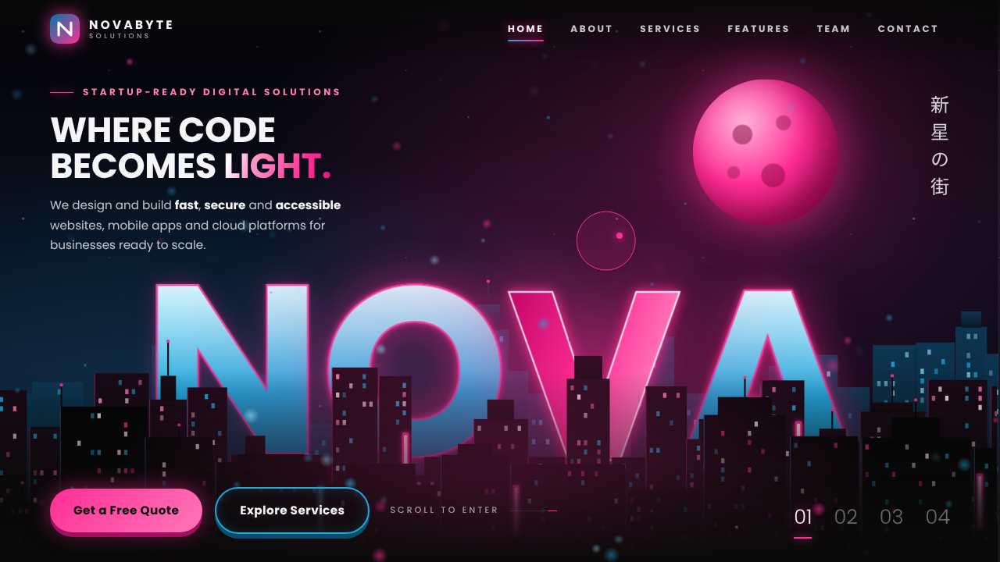
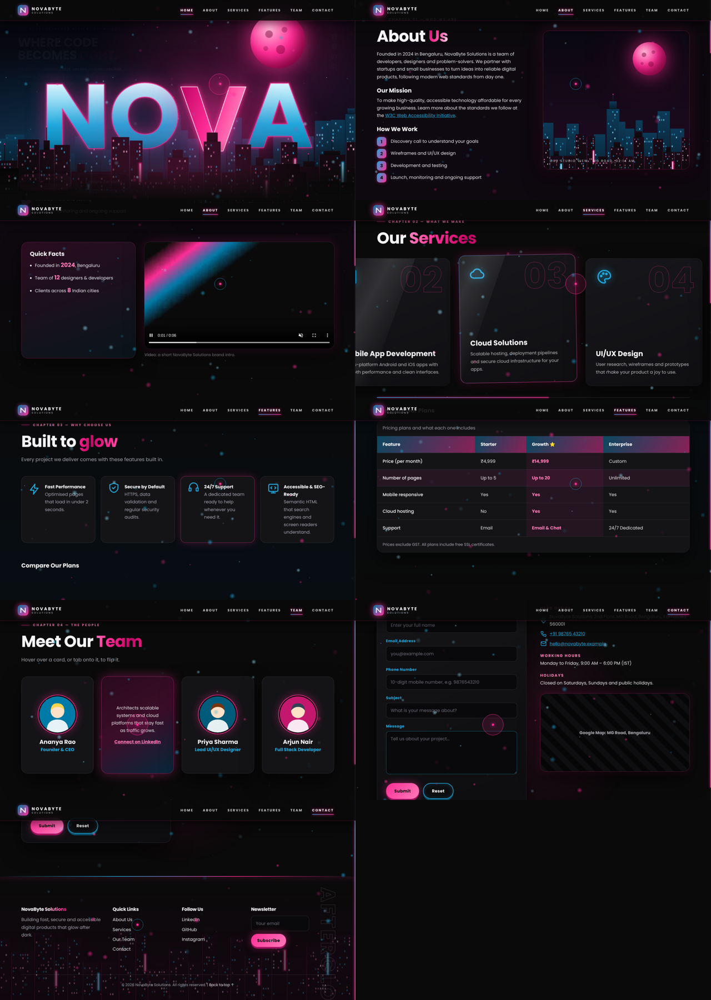
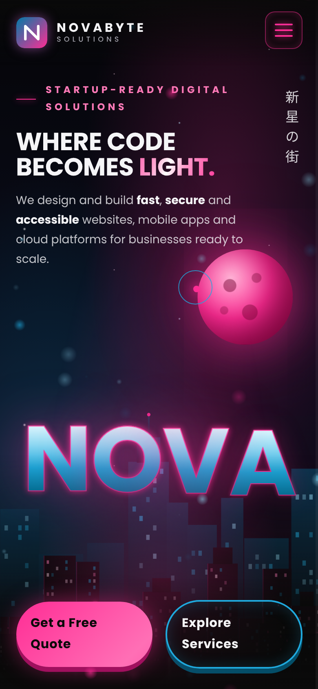
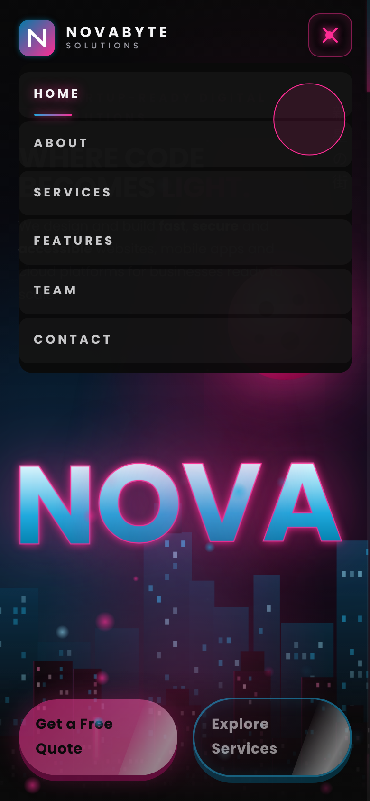
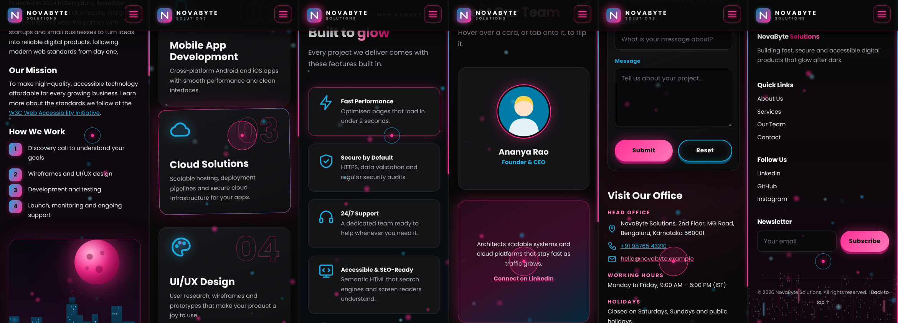

# NovaByte Solutions – Immersive Responsive Website

**ApexLark Full Stack Development Internship – Day 02 Task**
**Topic:** CSS3 Styling, Flexbox & Responsive Web Design
**Intern:** _Your Name_ &nbsp;|&nbsp; **Date:** 03 November 2026

---

## Project Title

**NovaByte Solutions – "Where Code Becomes Light"**

A corporate website for a fictional tech startup. It is styled as an immersive neon city: giant 3D letters sit
between layers of the skyline and move as you scroll.

## Objective

To style the Day 1 semantic HTML website with modern CSS3 in an **external stylesheet**, build the layouts
with **Flexbox**, and make the page fully **responsive** on mobile, tablet and desktop.

## Design Theme

| Colour | Hex | Used for |
|--------|-----|----------|
| Jet Black | `#0A0A0A` | Background |
| Cerulean Blue | `#007BA7` → `#1FA9DD` | Hero letters, icons, labels, links |
| Neon Rose | `#FF2D95` | Glowing letter outlines, shiny headings, buttons, moon |

- **Font:** [Poppins](https://fonts.google.com/specimen/Poppins) from Google Fonts
- **Hero letters:** cerulean blue fill with a glowing neon rose outline. They fly in one by one, float, flicker
  like neon signs, and jump and turn rose when you hover over them.

## Page Sections

Header · Navigation Bar · Hero · About · Services · Features · Team · Contact · Footer

## Features Implemented

### CSS Styling (`css/style.css`)
- **External stylesheet** organised into 18 numbered, commented sections
- **Google Fonts** (Poppins) and a **custom colour palette** stored in CSS variables
- **Backgrounds and gradients:** layered night sky, shiny rose text gradient, gradient borders
- **Borders and border-radius:** rounded cards, pill buttons, glowing borders
- **Margin, padding and box shadows:** consistent spacing and neon glow shadows
- **Hover effects and smooth transitions** on links, buttons, cards, table rows and form fields

### Flexbox Layouts
Each section below uses `display: flex` with `justify-content`, `align-items`, `flex-wrap` and `gap`:

| Section | Flex container(s) |
|---------|-------------------|
| Navigation bar | `.header-inner`, `.main-nav ul` |
| Hero | `.layer-title`, `.big-title`, `.hero-bottom`, `.hero-actions` |
| About | `.stats`, `.about-grid`, `.about-extra` |
| Services | `.services-sticky`, `.services-track`, `.panel` |
| Features | `.feature-list`, `.feature-list li` |
| Team | `.team-grid`, `.flip-front`, `.flip-back` |
| Contact | `.contact-grid`, `fieldset`, `.form-actions` |
| Footer | `.footer-grid`, `.newsletter` |

### Responsive Design (Media Queries)
| Device | Breakpoint | Changes |
|--------|-----------|---------|
| Desktop | `> 992px` | Full layered hero, pinned sideways-scrolling services, 4 cards per row |
| Tablet | `577px – 992px` | Centred navigation, larger letters, 2 cards per row |
| Mobile | `≤ 576px` | **Hamburger menu** (CSS only), stacked services, 1 card per row, full-width buttons |

### UI Enhancements
- **Animated nav links:** a glowing underline grows from the centre, and the current section's link stays lit
- **Smooth scrolling** (`scroll-behavior: smooth`)
- **Hover card effects:**
  - service cards lift, tilt and get a moving neon border with a light sweep;
  - feature cards glow;
  - team cards flip in 3D.
- **Styled contact form:**
  - neon focus glow on each field;
  - the whole form glows while you fill it in;
  - borders turn red or blue to show whether the input is valid.
- **Layered parallax hero:** sky, moon, three city layers and the letters move at different speeds
  (parallax), with a gentle tilt that follows the mouse
- **Pinned services:** the section locks in place and the cards slide sideways as you scroll (desktop and tablet)
- **Extras:**
  - loading screen;
  - custom glowing cursor (mouse devices only);
  - floating neon particles;
  - scroll progress line;
  - counting numbers;
  - content that slides in as you scroll.
- **Accessibility:**
  - skip link and visible focus styles;
  - alt text, and decorative layers hidden from screen readers;
  - all animations switch off when "reduce motion" is turned on.

> **About JavaScript:** All styling and layout are pure CSS. The small optional file `js/main.js` only adds
> the scroll effects. Without it the website still works and looks complete.

### Day 1 HTML requirements (kept)
- Headings H1–H6 and paragraphs, ordered and unordered lists, images and links, a pricing table
  (`caption`, `thead`, `tbody`, `tfoot`)
- Contact form (`required`, `type="email"`, `type="tel"`, `placeholder`) with Submit and Reset buttons
- Video, and a Google Map embedded with an `<iframe>`

## Folder Structure

```
Day-02-CSS/
│
├── index.html                 # Semantic HTML5 page
├── css/
│   └── style.css              # External stylesheet
├── js/
│   └── main.js                # Optional scroll effects
├── assets/
│   ├── images/                # City skyline layers, team avatars, video poster
│   ├── icons/                 # Logo and SVG icons
│   └── media/
│       └── intro-video.mp4
├── screenshots/
│   ├── desktop.png
│   ├── desktop-sections.png
│   ├── mobile.png
│   ├── mobile-menu.png
│   └── mobile-sections.png
└── README.md
```

## How to Run

1. Clone the repository:
   ```bash
   git clone https://github.com/<your-username>/Day-02-CSS.git
   ```
2. Open the folder in **Visual Studio Code**.
3. Open `index.html` in **Google Chrome**, or right-click it and choose **Open with Live Server**.
4. Scroll slowly through the hero and move your mouse over the letters.
5. To test the responsive layouts, press `F12`, click the **device toolbar** icon, and pick a phone or tablet.

## CSS Validation

`css/style.css` was checked with the **W3C CSS Validation Service**
(https://jigsaw.w3.org/css-validator/#validate_by_upload) and all errors were fixed.
Vendor-prefixed properties such as `-webkit-background-clip` and `-webkit-text-stroke` appear only as
**warnings**, because they are browser-specific extensions. They are not errors.

## Screenshots

### Desktop – Hero


### Desktop – All sections


### Mobile
| Hero | Menu open |
|------|-----------|
|  |  |



## Tools Used
HTML5 · CSS3 · JavaScript (optional effects) · Visual Studio Code · Google Chrome DevTools · Google Fonts ·
W3C CSS Validator · Git & GitHub

## Learning Outcomes
- Styled a complete website with CSS3: variables, gradients, shadows, transitions and keyframe animations
- Built every major layout with Flexbox
- Used media queries for mobile, tablet and desktop breakpoints
- Used 3D transforms, layering (`z-index`) and `position: sticky` to create depth and scroll effects

---
© 2026 NovaByte Solutions (fictional company created for the ApexLark internship task).
